# RAG8s — Enterprise RAG Platform for Internal Knowledge Bases

RAG8s is a production-focused Retrieval-Augmented Generation (RAG) platform built on Kubernetes (AWS EKS), comprising eight independently deployable microservices. It combines streaming inference, OIDC authentication, per-user rate limiting, GitOps deployments, Infrastructure as Code, Karpenter Spot autoscaling, and end-to-end observability.

The platform implements the complete RAG lifecycle: document ingestion, preprocessing, sentence-aware chunking, vector indexing, hybrid retrieval, conditional reranking, and streaming LLM inference. Application-managed citations reference retrieved passages and link to original documents through pre-signed S3 URLs.

RAG8s is designed for querying indexed company documentation, technical manuals, internal policies, and operational runbooks, where reliable retrieval and traceable sources matter more than real-time data ingestion.

### Key Features

- **Offline evaluation** — 75 curated test records tracked in MLflow. Latest results: groundedness **0.95**, citation integrity **0.89**, and recall@3 **0.72**. Evaluation uses `top_k=3` to stay within Bedrock rate limits; production defaults to `top_k=5`.
- **Citation grounding** — the application assigns citation IDs to retrieved passages; the LLM references these predefined IDs. Invalid citation IDs are stripped, and valid citations link to source documents through pre-signed S3 URLs.
- **Cost and access control** — exact and semantic caching reduce redundant model calls. Rate limiting defaults to **5 requests/minute per authenticated user**, keyed by JWT subject rather than IP, spot EC2s for stateless. 
- **Observability** — Prometheus metrics and 24 alerts, structured logs retained in ClickHouse for 30 days, and retrieval metadata for debugging.

## Explore the Platform

- [RAG Pipeline](#rag-pipeline-overview) — ingestion, retrieval, reranking, and generation.
- [Offline Evaluation](#offline-evaluation) — metrics, methodology, and limitations.
- [Deployment Guide](#step-by-step-deployment-guide) — infrastructure setup and deployment.

---

## Demo: Grounded Answers & Citations

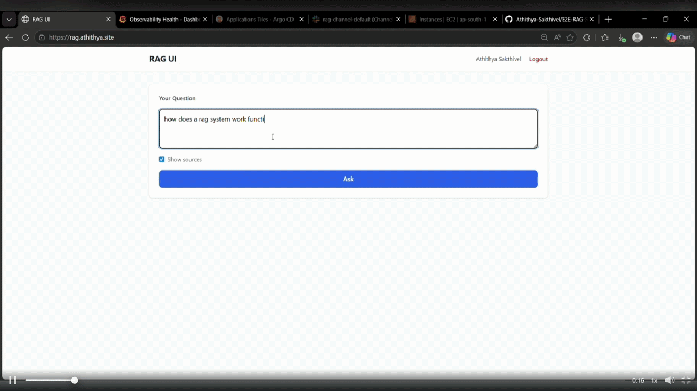

*The embedded GIF is a preview*. Open the [full demo](https://www.linkedin.com/posts/athithya-sakthivel-a23062341_rag-kubernetes-aws-ugcPost-7462146556369068032-HWum/) for a clearer view.

---

# Architecture

The RAG lifecycle is separated into two independent execution planes:

**[Batch Indexing Plane](src/indexing_pipeline/README.md)**

An incremental, idempotent pipeline that ingests documents from S3, extracts and normalizes content, performs OCR, creates traceable chunks, generates dense and sparse embeddings, and upserts them into Qdrant with positional metadata. Configurable thresholds trigger automatic backups.

**[Online Inference Plane](src/services/inference_pipeline.md)**

A low-latency streaming pipeline with OIDC authentication, per-user rate limiting, exact and semantic caching, hybrid Qdrant retrieval with Reciprocal Rank Fusion (RRF), and conditional cross-encoder reranking. Answers stream from AWS Bedrock with predefined citation IDs validated against retrieved passages and links to original documents via pre-signed S3 URLs.

---


# RAG Pipeline Overview

The operational heart of the system. Everything else — Kubernetes, IAM, observability — exists to make this pipeline reliable, debuggable, and cheap to run.

> Inference Control Flow: exact cache → parallel dense+sparse embed → semantic cache → hybrid Qdrant with RRF → conditional cross-encoder rerank → numbered prompt → Bedrock with guardrails → structural citation validation → background cache write-back. Every external dependency has an independent circuit breaker and a fallback, so the failure mode is a worse answer, not an error.

## 1. Document Extraction & Chunking (e.g., PDF)

**PDF extraction** uses PyMuPDF for text, layout, and images, and pdfplumber for tables. Column layouts are reconstructed from text-block coordinates. Captions are associated with figures, and images larger than 3 KB are processed using RapidOCR at 300 DPI, with Tesseract as a fallback. Font artifacts are removed during cleaning.

**Chunking** preserves sentence boundaries and source traceability:

- spaCy sentence segmentation, with fallback strategies.
- Token counting with `tiktoken` (`cl100k_base`).
- Maximum chunk size: `512` tokens by default.
- Sentence overlap: `2` by default.
- Minimum chunk size: `100` tokens by default; smaller chunks merge with the previous chunk.
- Oversized sentences are split to prevent content loss.

Each chunk stores deterministic identifiers, source and page metadata, parser version, semantic region, and associated figure, OCR, caption, or table content.

## 2. Retrieval

Retrieval follows a fixed workflow rather than an agent loop.

1. **Exact cache:** Returns cached answers using a key derived from the normalized query, corpus and prompt versions, retrieval version, model, tenant, `top_k`, and `fetch_k`.
2. **Parallel embeddings:** Dense and sparse query embeddings are generated concurrently, each protected by an independent circuit breaker.
3. **Semantic cache:** Searches using a strict similarity threshold of approximately `0.84`, followed by a relaxed threshold of `0.78`.
4. **Hybrid search:** Qdrant retrieves dense and sparse results in parallel and combines them using Reciprocal Rank Fusion (RRF).
5. **Conditional reranking:** A cross-encoder reranks results when retrieval confidence is low or the top two candidates have similar scores.
6. **Prompt construction:** Retrieved passages are numbered and inserted into a grounded prompt.
7. **Generation:** Amazon Bedrock streams the answer with AWS Guardrails enabled.
8. **Citation validation:** The application validates generated citation references against the passages supplied in the prompt.
9. **Cache write-back:** Results are cached in a background task without delaying the response stream.

### Hybrid Ranking: Reciprocal Rank Fusion (RRF)

Reciprocal Rank Fusion combines dense and sparse results using their ranks rather than raw scores, allowing the two retrieval methods to be merged without requiring their score scales to match.

```text
RRF(d) = Σ [1 / (60 + rank_r(d))]
         r ∈ R
```

Where:
- `d` is a document.
- `R` is the set of ranked result lists.
- `rank_r(d)` is the position of document `d` in list `r`.
- `60` is the RRF constant, which reduces the influence of lower-ranked results.

### Reranking

Reranking runs only when needed. Normalized reranker and fusion scores are blended using a configurable weight, `α`. Candidates outside the reranking pool retain their relative order and follow the reranked results. If reranking fails, the system falls back to the original fusion ranking.

## 3. Citation Grounding

**Citations are assigned by the application, not invented by the LLM.** Retrieved passages receive numbered identifiers (`[1]`, `[2]`, etc.) before being added to the prompt. The LLM references these identifiers in its answer.

After generation, the application checks every citation against the supplied passages and removes invalid references. If validation leaves the answer empty, `deterministic_summarize` provides a fallback.

This prevents invalid citation IDs but does not verify whether a cited passage semantically supports the associated claim.

## 4. Caching and Resilience

- **Exact cache:** Avoids repeated retrieval and generation for identical requests.
- **Semantic cache:** Reuses answers for sufficiently similar queries; cache hits are promoted to the exact cache.
- **Expiration:** Entries expire according to env var `CACHE_TTL_SECONDS` and are removed by a background cleanup loop.
- **Fault tolerance:** Independent circuit breakers and fallbacks allow degraded operation when external components fail.
- **Observability:** Responses expose retrieval mode, dense and sparse result counts, fused result counts, and reranking metadata.

## 5. Embedding and Generation Models

Embeddings are self-hosted because changing the embedding model requires re-embedding the corpus and rebuilding the Qdrant index. Generation uses Amazon Bedrock, allowing the LLM to change independently without re-indexing the corpus.

---

## Cloud Infrastructure

Infrastructure is managed with OpenTofu across AWS and Cloudflare.

- **[AWS Infrastructure](src/infra/terraform/aws/)** — Runs applications on EKS, with on-demand nodes for core services and Karpenter-managed Spot instances for scalable, stateless inference workloads. Qdrant stores persistent vector data on EBS, S3 stores infrastructure state, and ECR hosts container images. GitHub Actions publishes images using OIDC authentication, avoiding long-lived credentials.

- **[Cloudflare Infrastructure](src/infra/terraform/cloudflare/README.md)** — Secures external access through a single Cloudflare Tunnel with strict SSL and DDoS protection, without publicly exposed AWS IP addresses or load balancers.

---

## Microservices

| Source / Service | Role | Key Details |
|---|---|---|
| [Frontend](src/services/frontend/README.md) | Authentication and chat UI | Google/Microsoft OAuth, short-lived JWTs, streaming request proxy |
| [Retriever](src/services/retriever/README.md) | RAG orchestration | Caching → hybrid retrieval → conditional reranking → Bedrock streaming → citation validation |
| [Dense Embedder](src/services/dense/README.md) | Dense vector generation | **CPU by default**, FastEmbed, `BAAI/bge-small-en-v1.5`, 384-dimensional normalized vectors |
| [Sparse Embedder](src/services/sparse/README.md) | Sparse vector generation | **CPU by default**, FastEmbed, `Qdrant/minicoil-v1`, stateless |
| [Reranker](src/services/reranker/README.md) | Document relevance scoring | **CPU by default**, cross-encoder `Xenova/ms-marco-MiniLM-L-6-v2`, conditionally triggered |
| [Indexing CronJob](src/indexing_pipeline/README.md) | Batch document ingestion | Document conversion → chunking → embedding → Qdrant upserts → [conditional backups](https://github.com/Athithya-Sakthivel/RAG8s/blob/main/src/indexing_pipeline/README.md#trigger-logic) |
| [Valkey](https://valkey.io/topics/quickstart/) | Distributed rate limiting | Shared rate-limit counters across Retriever replicas; NetworkPolicy isolation |
| [Cloudflared](https://developers.cloudflare.com/tunnel/) | Secure external connectivity | Cloudflare Tunnel to internal services; observability endpoints blocked at edge; Prometheus metrics |

---

## Connectivity & Auth

External traffic enters through a single **Cloudflare Tunnel** with strict SSL and no publicly exposed origin IPs or load balancers. **Google and Microsoft OAuth** provide authentication, with short-lived JWTs and domain allowlists.

**DDoS mitigation and rate limiting:**
- **Cloudflare edge:** DDoS mitigation before traffic reaches the cluster.
- **Per-user:** 5 requests/minute at the frontend, keyed by JWT subject, to limit LLM spend.
- **Per-IP:** 60 requests/minute on `/generate/stream` and 30/minute on `/presign` at the Retriever.

---

## Observability

Built-in, no external SaaS required:

- **Prometheus + Alertmanager** — 20+ alert rules, Slack notifications with inhibition rules
- **Grafana** — auto-discovered dashboards via ConfigMap sidecar
- **Vector + ClickHouse** — structured JSON log aggregation with 30-day retention

---

## Security

Layered across the full stack:

- **Edge:** Cloudflare Tunnel with SSL strict and endpoint filtering
- **Auth:** OIDC with PKCE and CSRF state protection, ES256 JWTs (15-min TTL), per-provider domain/org/tenant allowlists
- **Network:** Kubernetes NetworkPolicies isolating namespaces by function
- **IAM:** IRSA for least-privilege AWS access, GitHub Actions OIDC with per-repo roles
- **Runtime:** Read-only root filesystems, non-root containers, no privileged pods
- **CI/CD:** Pre-commit Gitleaks hook + CI-side scanning (Gitleaks, Trivy, OpenGrep) on every commit
- **GitOps:** Argo CD reconciles cluster state from Git, self-heals drift, rollbacks via `git revert`

---

## Offline Evaluation

Automated evaluation against a 75-record golden dataset, tracked in MLflow.

```
cat src/offline_eval/offline_eval_artifacts/summary.json
```

```json
{
  "meta": { "records": 75, "top_k": 3 },
  "performance": { "success_rate": 1.0 },
  "retrieval": {
    "recall_at_3": 0.72,
    "mrr": 0.5793
  },
  "generation": {
    "fact_coverage": 0.7769,
    "groundedness": 0.9459,
    "response_similarity": 0.2498
  },
  "citations": {
    "citation_integrity": 0.8933
  },
  "errors": { "rate": 0.0 }
}
```

### Golden set composition

Each record defines:

- `query` — a realistic employee question about the indexed corpus
- `expected_chunk_id` — the chunk that should be retrieved
- `reference_answer` — a hand-written ground-truth answer
- `expected_facts[]` — the atomic facts that must appear in a complete answer

The 75-record evaluation provides an initial signal across four metrics but may miss rare failure modes. Expanding to 500+ records, including adversarial cases, is planned.

### Eval caveats

- **Offline evaluation was run with `top_k=3`** to stay within Bedrock rate limits across the 75-record set. Production default is `top_k=5`, so recall is expected to be higher in operation. The next run will report both recall@3 and recall@5.
- **LLM-as-judge has biases.** It correlates well with human judgment but is not a substitute for it. A human-labeled subset for calibration is on the roadmap.
- **No online evaluation yet.** Feedback signals (thumbs, citation clicks) are not collected; offline metrics can drift from production behavior.
  
---

## Limitations

- **Not designed for real-time ingestion.** Documents are indexed through a scheduled batch pipeline, making RAG8s better suited to internal knowledge bases, technical documentation, policies, and runbooks that update periodically rather than continuously.
- **No per-document access filtering.** Authenticated users can query the full corpus. Query-time group-based filtering is required for enterprise access control.
- **No deletion reconciliation.** Deleting a source from S3 does not remove its Qdrant chunks. Soft tombstones with query-time filtering are planned.
- **Structural citation validation only.** Invalid citation IDs are detected, but citation entailment is not verified.
- **Single LLM provider.** Bedrock is currently the only generation provider.
- **Retrieval recall depends on chunking and embeddings.** Recall@5 is expected to improve with the production default `top_k=5`. Further gains can be achieved through larger embedding models and an updated evaluation dataset.
  
---

# Step-by-Step Deployment Guide

## Prerequisites

1. **Docker installed and running _without_ sudo access. Non-root is required for devcontainer stability. Run `sudo usermod -aG docker $USER && newgrp docker` if not already.**
2. **Visual Studio Code** with the [Dev Containers extension](https://code.visualstudio.com/docs/devcontainers/containers) for a reproducible dev environment.
3. **An AWS account with sufficient IAM permissions (AdministratorAccess or equivalent) to manage:**
   * Amazon EKS (Elastic Kubernetes Service)
   * EC2, VPCs, Subnets, and Security Groups
   * Amazon S3
   * IAM Roles, Policies, and Instance Profiles
   **AWS Free Tier is sufficient for development and testing purposes.**
4. **A Cloudflare account with a registered domain, with permissions to manage DNS records and create Cloudflare Tunnels (cloudflared).**

---

### PHASE 0.1 Clone the repo and build the devcontainer (Reproducible).

```sh
cd $HOME && rm -rf RAG8s && git clone https://github.com/Athithya-Sakthivel/RAG8s.git
cd RAG8s && code .
# Ctrl + Shift + P → Paste `Dev containers: Rebuild Container Without Cache` and Enter. 
```

> First-time build takes 5–15 minutes depending on network speed. You may create a GitHub codespace instead if network is slow.

---

### PHASE 0.2 Open a new terminal and log in to your `gh` account as shown below

```sh
git config --global user.name "Your Name"
git config --global user.email you@example.com
gh auth login

? What account do you want to log into? GitHub.com
? What is your preferred protocol for Git operations? SSH
? Generate a new SSH key to add to your GitHub account? No
? How would you like to authenticate GitHub CLI? Login with a web browser

! First copy your one-time code: <code>
- Press Enter to open github.com in your browser...
✓ Authentication complete. Press Enter to continue...
```

---

### PHASE 0.3 Create a new private repo in your GitHub account

```sh
export REPO_NAME="RAG8s" # or any name
git remote remove origin 2>/dev/null || true
gh repo create "$REPO_NAME" --private >/dev/null 2>&1
REMOTE_URL="https://github.com/$(gh api user | jq -r .login)/$REPO_NAME.git"
git remote add origin "$REMOTE_URL" 2>/dev/null || true
git branch -M main 2>/dev/null || true
git push -u origin main
git pull
git remote -v
echo "[INFO] A private repo '$REPO_NAME' created and pushed. Only visible from your account."
```

---

## Phase 1 — Infrastructure Foundation

### 1.1 Provision AWS Infrastructure

Creates the VPC, EKS cluster, S3 buckets, ECR repositories, and all IAM roles. Uses OpenTofu (Terraform-compatible).

```bash
export TF_VAR_region="ap-south-1"
export TF_VAR_github_repository=<user_name/<repo_name>"    # replace with your username and $REPO_NAME
bash src/infra/terraform/aws/run.sh --create --env staging
```

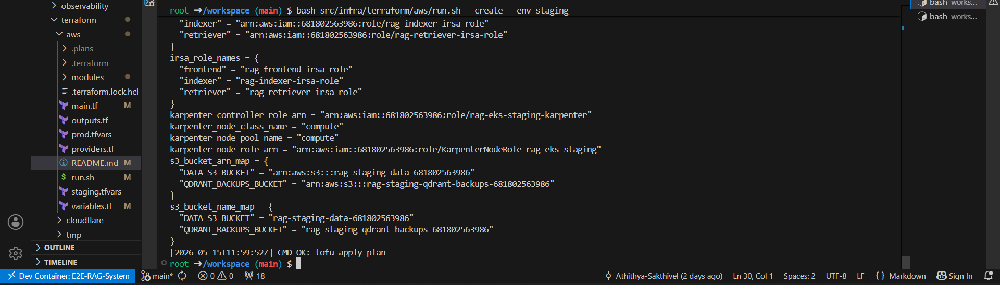

### 1.2 Connect to the New EKS Cluster

```sh
aws eks update-kubeconfig --region ap-south-1 --name rag-eks-staging
```

---

## Phase 2 — Container Images (CI/CD)

### 2.1 Trigger Image Builds to ECR

Replaces account IDs and region in CI workflow files so GitHub Actions can push images to your ECR. After running, open your repo's Actions tab — all 6 service images will build and push in ~5 minutes.

```sh
bash src/scripts/replace.sh
```

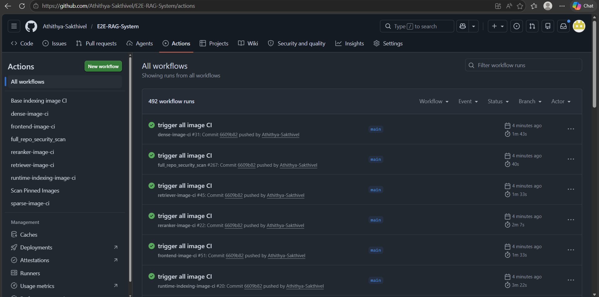

---

## Phase 3 — GitOps Controller & Auto-Scaling

### 3.1 Install Argo CD

Deploys the GitOps controller that will sync all applications from this repo. Requires a GitHub personal access token for private repo access. The secret shown is temporary.

```bash
export GIT_PAT=ghp_   # Visit https://github.com/settings/tokens/new
bash src/infra/core/argo_setup.sh --rollout
```

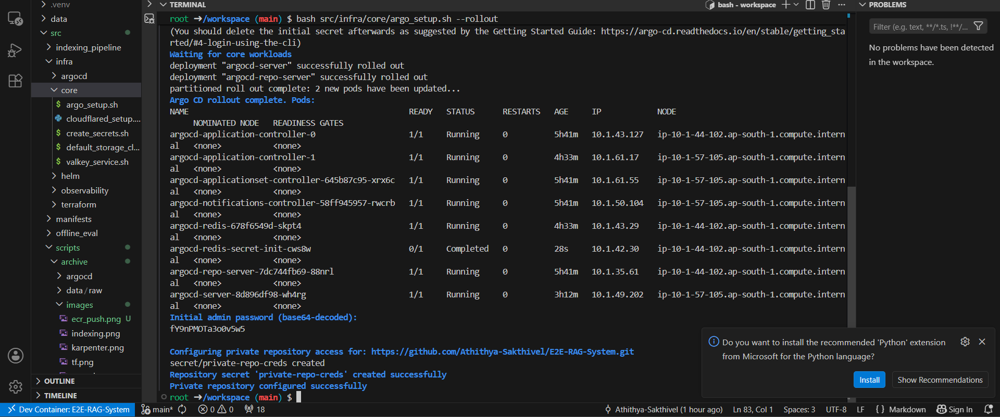

### 3.2 Bootstrap Karpenter for the stateless workloads

[Karpenter](https://karpenter.sh/docs/) automatically provisions EC2 Spot nodes labeled `node-type=compute:NoSchedule` for stateless workloads. The Frontend, Retriever, Embedders, Reranker, Indexing CronJob, and Cloudflared tunnel are scheduled onto these nodes using matching tolerations, while a Pod Disruption Budget keeps Cloudflared available. Underutilized nodes are automatically consolidated after 15 minutes (`WhenEmptyOrUnderutilized`).

```bash
export GH_REPO= # replace with your full repo url (https://github.com/<USER_NAME/$REPO_NAME.git)
export GH_BRANCH="main"
export AWS_REGION="ap-south-1"
bash src/scripts/eks/bootstrap_karpenter.sh --rollout
```

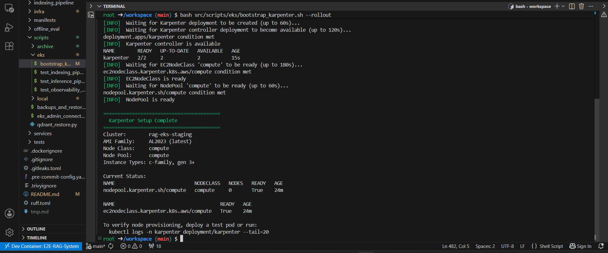

---

## Phase 4 — Data Ingestion & Vector Storage: Deploy the Indexing Pipeline

This phase sets up the complete document processing stack. It deploys Qdrant (a 3-node vector database for storing embeddings), FastEmbed services (three microservices for dense embeddings, sparse embeddings, and reranking), and finally the indexing CronJob that runs on a schedule.

Once deployed, this pipeline automatically handles the full document lifecycle: upload a few PDFs and HTMLs to S3, ingest raw files from S3, convert them to text (including OCR for pages/slides with images), split them into smaller chunks, generate embeddings for each chunk, and index them into Qdrant for fast retrieval.

See the [indexing pipeline documentation](src/indexing_pipeline/README.md) for configuration details.

```bash
export HF_TOKEN=   # Hugging Face token for faster model downloads (optional)
bash src/scripts/eks/run_indexing_pipeline.sh
```

> **NOTE:** Karpenter may take 5–15 minutes to provision EC2 instances if the cheapest matching instance type is unavailable. It retries with other c-family types automatically. Pods will stay Pending until a compatible instance launches.

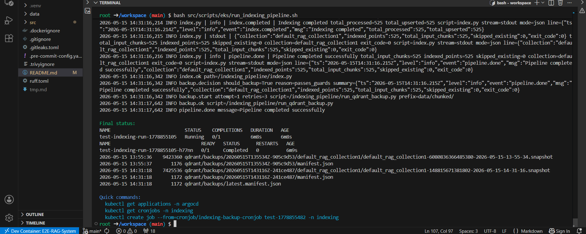

---

## Phase 5 — External Access & DNS: Set Up Cloudflare Tunnel and DNS

Creates DNS records and a [Cloudflared/Argo tunnel](https://developers.cloudflare.com/tunnel/) that securely routes traffic to your cluster — no LoadBalancers or public IPs needed. The script waits for you to authorize Cloudflare access.

```sh
export CLOUDFLARE_ACCOUNT_ID=      # Cloudflare dashboard > Account Home > Search and enter "Copy account ID".
export CLOUDFLARE_GLOBAL_API_KEY=  # https://dash.cloudflare.com/profile/api-tokens > API Keys
export CLOUDFLARE_EMAIL=           # example: "athithya651@gmail.com"
export DOMAIN=                     # example: "athithya.site"

bash src/infra/terraform/cloudflare/run.sh --apply

# Export tunnel credentials
export CLOUDFLARE_TUNNEL_TOKEN="$(tofu -chdir=src/infra/terraform/cloudflare output -raw cloudflare_tunnel_token)"
export CLOUDFLARE_TUNNEL_NAME="$(tofu -chdir=src/infra/terraform/cloudflare output -raw cloudflare_tunnel_name)"
export CLOUDFLARE_TUNNEL_ID="$(tofu -chdir=src/infra/terraform/cloudflare output -raw cloudflare_tunnel_id)"

# Deploy cloudflared with secrets
python3 src/infra/core/cloudflared_setup.py --write
```

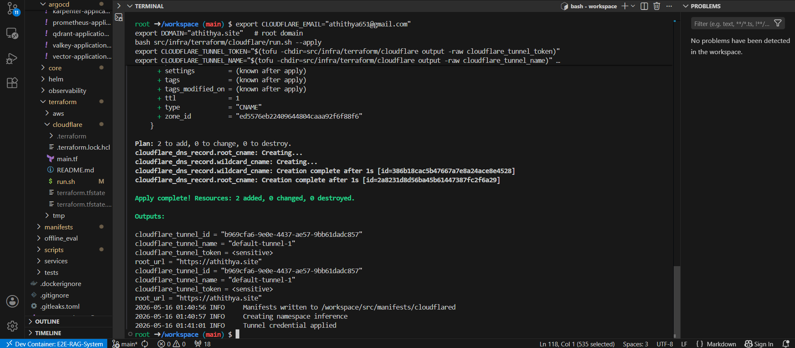

---

## Phase 6 — Query Engine & User-Facing Services: Deploy the Inference Stack

Launches the [retriever](src/services/retriever/README.md), [Chat UI + OIDC authentication](src/services/frontend), Valkey (for per-user rate limiting), and the [Cloudflared tunnel](https://developers.cloudflare.com/tunnel/). Configure OAuth credentials for Google, Microsoft, or both — enabling *either provider is sufficient* for user authentication.

> **Create OAuth Credentials** [Google](https://oauth2-proxy.github.io/oauth2-proxy/configuration/providers/google/#usage) | [Microsoft](https://oauth2-proxy.github.io/oauth2-proxy/configuration/providers/ms_entra_id)

```sh
export DOMAIN=                 # Use the same $DOMAIN
export GOOGLE_CLIENT_ID=             # Google OAuth client ID
export GOOGLE_CLIENT_SECRET=          # Google OAuth client secret
export GOOGLE_ALLOWED_DOMAINS="company.com,gmail.com"        # Comma-separated allowed email domains
export MS_CLIENT_ID=                       # Azure AD application (client) ID
export MS_CLIENT_SECRET=                   # Azure AD client secret
export MICROSOFT_ALLOWED_TENANT_IDS=       # Primary tenant ID (single-tenant or common)
export MICROSOFT_ALLOWED_DOMAINS="outlook.com,company.com"   # Comma-separated allowed email domains

bash src/scripts/eks/run_inference_pipeline.sh
```

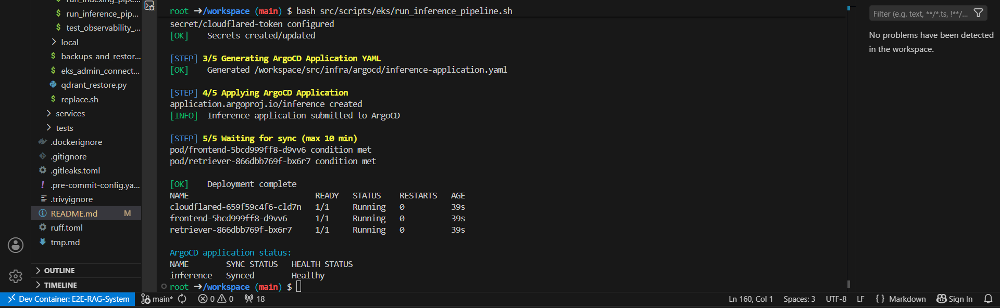

---

## Phase 7 — Observability

### 7.1 Deploy Monitoring, Logging, and Alerting

Sets up Prometheus (metrics + alerts), Grafana (dashboards), ClickHouse (log storage), and Vector (log collector). Optionally connect Slack and PagerDuty for alerts.

```sh
export CLICKHOUSE_USER=vector
export CLICKHOUSE_PASSWORD=vectorpass
export SLACK_WEBHOOK_URL=   # Optional: Slack alerting
export PAGERDUTY_ROUTING_KEY=   # Optional: PagerDuty escalation
export ADMIN_PASSWORD=grafana # set strong password
bash src/scripts/eks/observability_setup.sh
```

---

## End-to-End System Complete

The deployment reproduces the **ground-truth configuration** shown in the project demo, including semantic caching, OAuth-authenticated per-user rate limiting, hybrid retrieval, and the complete RAG inference pipeline.

| URL | Service |
|------|---------|
| `https://rag.<DOMAIN>` | RAG Chat UI (Google/Microsoft sign-in) |
| `https://argocd.<DOMAIN>` | Argo CD (GitOps dashboard) |
| `https://grafana.<DOMAIN>` | Grafana (observability dashboards) |

> **Note:** OIDC allows all Google and Microsoft accounts by default. For production, restrict access with `GOOGLE_ALLOWED_DOMAINS` and `MICROSOFT_ALLOWED_TENANT_IDS`.

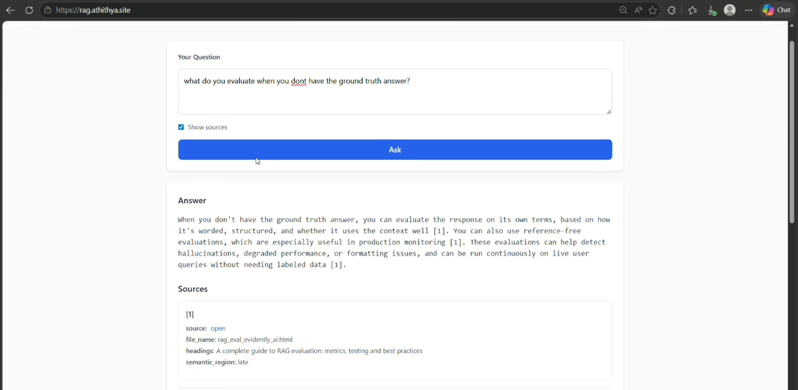

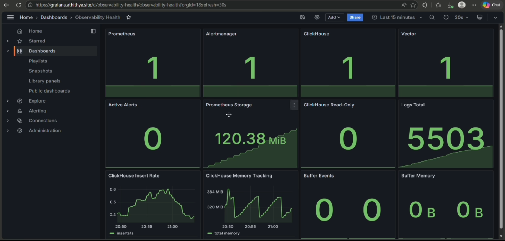

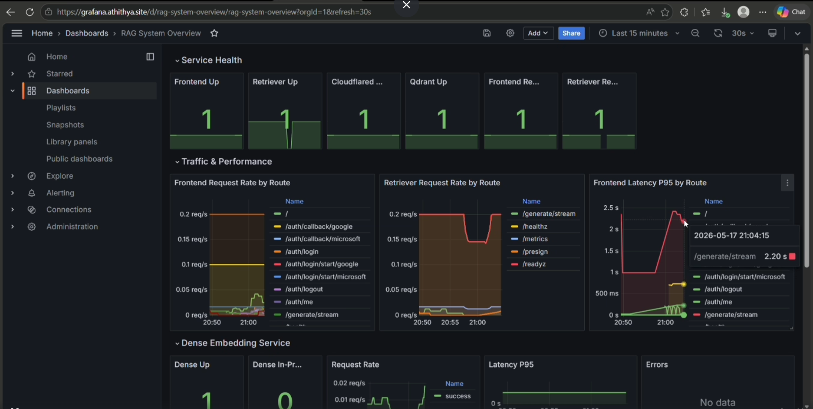

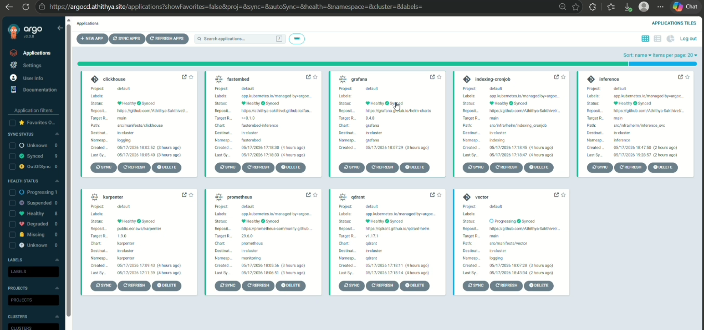

---

## Optional — Test Alerting and Disaster Recovery

Simulate a complete Qdrant outage to verify Slack alerts fire and data can be restored from S3 backups.

```sh
# 1. Pause ArgoCD sync to prevent auto-healing during the test
kubectl patch application qdrant -n argocd --type='merge' \
  -p '{"spec": {"syncPolicy": null}}'

# 2. Delete Qdrant and its persistent volumes
kubectl delete pvc -n qdrant --all --ignore-not-found=true
kubectl delete namespace qdrant --ignore-not-found=true

# 3. Wait for the QdrantDown alert to trigger (~3 minutes)
echo "Waiting for QdrantDown alert..."
sleep 180

# 4. Re-enable ArgoCD — it recreates Qdrant with fresh volumes
kubectl patch application qdrant -n argocd --type='merge' \
  -p '{"spec": {"syncPolicy": {"automated": {"prune": true, "selfHeal": true}}}}'
echo "Waiting for ArgoCD to recreate Qdrant..."
sleep 180

# 5. Confirm Qdrant is back but empty
kubectl port-forward -n qdrant svc/qdrant 6333:6333 &>/dev/null & sleep 3
echo "Points before restore:"
curl -s http://localhost:6333/collections/default_rag_collection1 | jq '.result.points_count // 0'
kill %1 2>/dev/null || true

# 6. Restore from the latest S3 backup
export DATA_S3_BUCKET=$DATA_S3_BUCKET
export QDRANT_BACKUP_S3_PREFIX="qdrant/backups/"
bash src/scripts/backups_and_restore.sh restore

# 7. Verify data recovery
sleep 10
kubectl port-forward -n qdrant svc/qdrant 6333:6333 &>/dev/null & sleep 3
echo "Points after restore:"
curl -s http://localhost:6333/collections/default_rag_collection1 | jq '.result.points_count // 0'
kill %1 2>/dev/null || true
```

**What this validates:**

- Alertmanager fires `QdrantDown` and notifies Slack
- ArgoCD self-heals infrastructure when re-enabled
- S3 backups are restorable with point-count parity

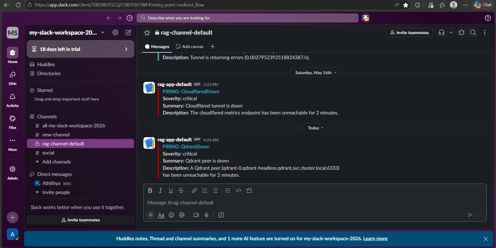

---

## Cleanup

To tear down the entire infrastructure and avoid ongoing costs:

> **Note:** Karpenter manages AWS resources (EC2 instances, VPC tags) outside Terraform state. If `terraform destroy` hangs, manually delete the VPC and verify no orphaned EC2 instances remain.

```sh
# 1. Remove workloads to trigger Karpenter scale-down
kubectl delete ns inference --ignore-not-found
kubectl delete ns fastembed --ignore-not-found
sleep 600 

# 2. Destroy Cloudflare resources
bash src/infra/terraform/cloudflare/run.sh --destroy

# 3. Destroy AWS infrastructure
bash src/infra/terraform/aws/run.sh --destroy --env staging --yes-delete
```

**Post-cleanup verification:**

- Confirm no RAG8s-specific EC2 instances remain in the `TF_VAR_region`
- Verify the EKS cluster and associated security groups are removed
- Run `python3 src/scripts/eks/force_delete.py` as a last resort for orphaned resources

---
